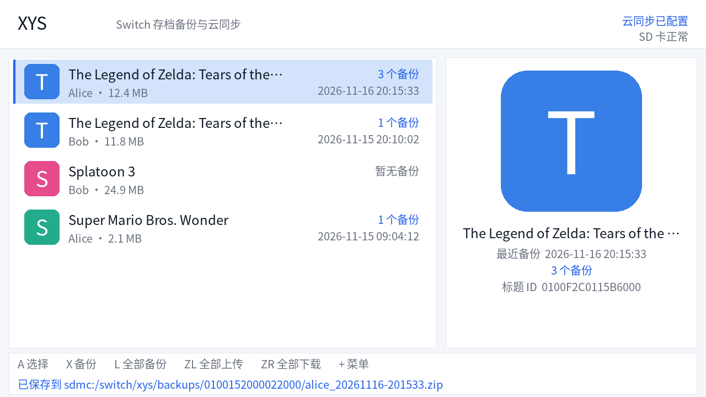
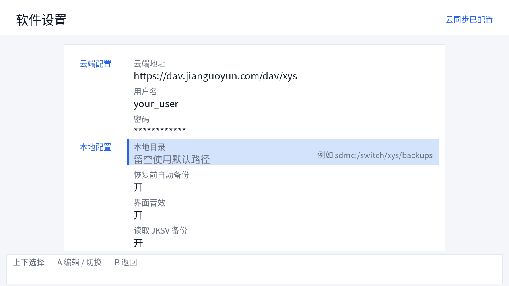

# XYS（XinYue Save）用户手册


Switch 存档备份与 WebDAV 云同步 homebrew（NRO），备份格式为与 JKSV 兼容的 ZIP。

- 版本：1.0.0
- 首次发布：2026-11-16
- 适用环境：Atmosphere + hbmenu（自制系统）

> 本文档与代码同步维护：功能、按键、配置项、目录结构有任何变化时，同时更新本文档。

---

## 1. 功能概览

| 功能 | 状态 | 说明 |
| --- | --- | --- |
| 图形界面 | 已实现 | SDL2 界面，1280×720，手柄操作 |
| 操作音效 | 已实现 | 移动、确认、取消、成功、失败五类短音效，无需额外音频文件，可在设置中关闭 |
| 存档图标预览 | 已实现 | 列表缩略图 + 右侧大图预览 |
| 系统语言自动切换 | 已实现 | 简体 / 繁体中文、英文自动适配 |
| 备份时间显示 | 已实现 | ZIP 文件名 + 界面均可读时间 |
| 枚举本机存档 | 已实现 | 所有账号的存档，以及设备存档（如《动物森友会》） |
| 本地备份 | 已实现 | ZIP，存档文件位于压缩包根目录，执行前需确认 |
| 无变化跳过备份 | 已实现 | 对比同用户最近备份的内容指纹，存档未变化时不重复生成 ZIP |
| 备份备注 | 已实现 | 备份列表按 `Y` 编辑，备注显示在时间后并保存在本地 |
| JKSV 兼容 | 已实现 | 导出含 JKSV 元数据；默认读取 JKSV 备份，可在设置中关闭 |
| 本地 / JKSV 恢复 | 已实现 | 备份列表可选；确认后显示进度条 |
| 云端版本列表与任意版本恢复 | 已实现 | 本地、JKSV、云端版本统一显示，可选择任意云端 ZIP 下载并恢复 |
| 恢复前自动快照 | 已实现 | 默认开启，可在设置中关闭；快照失败则中止恢复，云端恢复同样适用 |
| 备份 / 上传 / 下载进度与取消 | 已实现 | 后台线程执行，显示百分比，按 `B` 取消 |
| 删除备份 | 已实现 | 本地备份按 `X` 并确认后删除；云端版本也可在列表内删除 |
| 旧备份自动清理 | 已实现 | 每款游戏保留最近 `keep_backups` 份普通备份与快照，默认 10 份 |
| 软件内设置 | 已实现 | 菜单 → 软件设置，写入后立即生效 |
| 关于界面 | 已实现 | 版本、作者、简介、仓库地址       |
| WebDAV 上传 / 下载 | 已实现 | 直接同步 ZIP 文件，云端已有同名 ZIP 时跳过上传 |
| 一键备份全部 | 已实现 | 遍历列表逐个备份，执行前需确认，统计成功 / 跳过 / 失败数量 |
| 一键上传 / 下载全部 | 已实现 | 主界面 `ZL` / `ZR` 批量同步所有游戏；上传只处理已有本地备份的游戏，重复版本自动跳过 |
| 存档数值 / 内容浏览 | 未实现 | 各游戏格式不同，见路线图 |
| 定时自动备份 / 增量同步 | 未实现 | 无人值守自动备份、按 SHA256 差量同步，见路线图 |

---

## 2. 安装

1. 复制 `xys.nro` 到 SD 卡的 `sd:/switch/` 目录。
2. 在 hbmenu 中运行。

首次运行自动创建：

```
sd:/switch/xys/
├── config.ini          # 配置（自动生成）
├── backups/            # 备份根目录
└── tmp/                # 云端下载的临时 ZIP
```

备份根目录默认是 `sdmc:/switch/xys/backups`，可通过 `config.ini` 的 `backup_dir` 自定义。

---

## 3. 配置云同步

推荐在软件内配置：主界面按 `+` 打开菜单 → `软件设置`，用 `A` 逐项编辑云端地址、用户名、密码与备份目录，保存后立即写回 `config.ini` 并生效，无需拔卡改文件。“恢复前自动备份”“界面音效”“读取 JKSV 备份”按 `A` 直接在开 / 关之间切换。选中选项时，右侧会显示示例值，打开系统键盘时也会显示对应提示。

也可以直接编辑 `sd:/switch/xys/config.ini`（程序首次运行自动生成）：

```ini
# WebDAV 地址：指向一个已存在的目录，路径格式由服务商决定
# 以下为坚果云示例，其他服务见下方「常见服务端路径」
base_url=https://dav.jianguoyun.com/dav/xys
username=your_user
password=your_password
# 可选：自定义备份根目录，留空则使用 sdmc:/switch/xys/backups
backup_dir=
# 恢复前自动生成当前存档快照：1 开启（默认），0 关闭
auto_backup=1
# 界面音效：1 开启（默认），0 关闭
sound=1
# 读取 JKSV 备份：1 开启（默认），0 关闭
read_jksv=1
# 每款游戏最多保留多少份本地备份（0 = 不自动清理）
keep_backups=10
```

- `base_url` 指向一个**已存在**的 WebDAV 目录，程序会在其下自动创建 `<TitleID>/` 子目录。
- `backup_dir` 为空时使用默认目录 `sdmc:/switch/xys/backups`；填写时建议使用 `sdmc:/...` 绝对路径，末尾斜杠会自动去掉。
- `auto_backup` 默认为 `1`。开启时，每次恢复前会先生成一份 `AUTO_<用户名>_<时间>.zip` 快照；快照写入失败会直接取消本次恢复。
- 支持 `http://` 与 `https://`。HTTPS 使用内置 CA（`romfs:/cacert.pem`），自签名证书会失败。
- 仅支持 Basic Auth。
- 不配置 `base_url` 时，本地备份 / 恢复仍可正常使用。
- `sound` 默认为 `1`，设为 `0` 后移动、确认等提示音全部静音。
- `read_jksv` 默认为 `1`，设为 `0` 后不扫描 `sdmc:/JKSV`，备份列表不再显示 JKSV 的只读备份。
- `keep_backups` 默认为 `10`：普通备份与 `AUTO_` 快照各自保留最近 N 份，更旧的会自动删除；设为 `0` 表示不自动清理。

常见服务端路径：

| 服务 | base_url 示例 |
| --- | --- |
| Nextcloud | `https://cloud.example.com/remote.php/dav/files/<用户名>/switch-saves` |
| 群晖 WebDAV | `https://nas.example.com:5006/switch-saves` |
| 坚果云 | `https://dav.jianguoyun.com/dav/xys`（使用应用密码，详见下方示例） |

服务端需支持 `PROPFIND`、`MKCOL`、`PUT`、`GET`、`DELETE`；其中 `DELETE` 用于清理取消上传后留下的云端半成品。

### 坚果云完整示例

以 `https://dav.jianguoyun.com/dav/xys/` 为例，设置界面按下面填写：

| 设置项 | 填写内容 |
| --- | --- |
| 云端地址 | `https://dav.jianguoyun.com/dav/xys/` |
| 用户名 | 坚果云登录邮箱 |
| 密码 | 坚果云「第三方应用密码」 |

先在坚果云网页端或客户端，于「我的文件」下**手动新建 `xys` 文件夹**。程序只会用 `MKCOL` 创建 `<TitleID>/` 这一层，不会创建 `base_url` 本身；该文件夹不存在时上传会报 `MKCOL HTTP 409`。

应用密码在坚果云网页端生成：右上角头像 → 账户设置 → 安全选项 → 第三方应用管理 → 添加应用 → 生成密码。使用登录密码会返回 `HTTP 401`。

配置完成后，云端结构为：

```
https://dav.jianguoyun.com/dav/xys/
└── 0100152000022000/                              # 游戏 TitleID
    ├── Alice_20261116-201533.zip
    ├── Alice_20261117-090000.zip
    └── Bob_20261116-220000.zip
```

即上传请求 `PUT https://dav.jianguoyun.com/dav/xys/0100152000022000/Alice_20261116-201533.zip`，云端版本列表则用 `PROPFIND` 读取同一目录。

- 地址末尾的 `/` 可写可不写，程序会自动去掉。
- 文件夹名可以换成其他名字，只要与地址最后一段一致。
- 直接填 `https://dav.jianguoyun.com/dav/` 也能用，但各游戏的 TitleID 文件夹会铺在坚果云根目录，建议单独建一个目录。

---

## 4. 界面说明



> 界面由程序实际渲染（1280×720），游戏名称、账号与图标为演示数据。

界面包含以下区域：

1. **顶部状态栏**：程序名、云同步是否配置、SD 卡状态。
2. **左侧存档列表**：每行显示游戏图标、游戏名、用户名、存档大小、备份数量、最近备份时间。
3. **右侧预览区**：当前选中游戏的 256×256 图标大图、游戏名、最近备份时间、备份总数、TitleID。
4. **底部提示栏**：按键说明与最近一次操作结果（成功为蓝色，失败为红色）。
5. **备份列表弹窗**：标题显示游戏名与当前账号，列出该游戏在本地、JKSV 和云端的全部备份；云端版本单独标注为“云端”，本地版本显示“本地”，同一时间戳会出现两行。文件名带用户名时显示来源用户，自动快照标注为“自动”，备注显示在时间后。云端条目可以恢复，也可按 `X` 删除远端 ZIP，但不能编辑备注；JKSV 条目只读。按 `-`：本地行上传到云端，云端行下载到本地备份目录。
6. **菜单**：按 `+` 打开，包含软件设置、关于、退出程序；批量上传 / 下载改为主界面 `ZL` / `ZR`，各自带确认提示。
7. **设置界面**：按云端配置和本地配置分组，可编辑云端地址、用户名、密码、备份目录，以及恢复前自动备份、界面音效和读取 JKSV 备份开关；本地目录留空使用默认路径，保存后立即生效。
8. **进度浮层**：备份、上传、下载、读取云端列表与恢复时显示标题和当前步骤；后台任务显示百分比并可按 `B` 取消，恢复只显示进度。
9. **关于界面**：显示程序图标、版本、作者、简介与仓库地址。





语言行为：

- 跟随系统语言自动切换：简体中文、繁体中文显示中文，其他语言显示英文。
- 游戏名取该游戏 NACP 中与系统语言匹配的名称；缺失时自动回退到其他可用语言，再回退到 `Unknown`。
- 用户名取账号昵称（支持中文等 UTF-8 字符），读取失败时显示 `User`；设备存档显示为 `设备`。
- 《动物森友会》等使用设备存档（Device SaveData）的游戏会显示在列表中，用户名为 `设备`，备份与恢复方式与其他游戏相同。

图标来源：

- 备份目录里的 `icon.jpg`（备份时写入，换机器 / 卸载游戏后仍可显示）。
- 没有备份图标时，实时读取已安装游戏的 NACP 图标。
- 两者都没有时显示首字母占位图。
- 预览的是游戏图标，不是存档内截图；存档内截图并非所有游戏都有，暂不支持。

---

## 5. 按键

| 按键 | 作用 |
| --- | --- |
| 十字键 上 / 下 | 选择游戏或菜单项（长按约 130ms 后开始连续滚动） |
| 十字键 左 / 右 | 翻页（每次移动 6 行） |
| 左 / 右摇杆 上 / 下 | 同十字键上下，选择条目（长按同样连续滚动） |
| 左 / 右摇杆 左 / 右 | 同十字键左右，翻页 |
| A | 打开选中游戏的备份列表（配置云端后同时读取云端版本）；在菜单 / 设置中确认 |
| X | 备份选中游戏的存档（需确认）；在备份列表里删除选中的本地备份或云端版本 |
| Y | 备份列表：编辑选中本地备份的备注 |
| -（Minus） | 备份列表：选中本地备份时上传该 ZIP；选中云端备份时下载到本地备份目录 |
| L | 备份当前列表中的全部存档（需确认） |
| ZL | 上传全部游戏的最新本地备份（需确认） |
| ZR | 下载全部游戏的云端最新版本（需确认） |
| R | 重新扫描存档与备份 |
| B | 取消当前操作 / 返回上一级；备份、上传、下载、读取云端列表时请求取消 |
| + | 打开菜单（软件设置、关于、退出） |

设置界面：`上 / 下` 选择项目，`A` 调出系统键盘编辑；“恢复前自动备份”“界面音效”“读取 JKSV 备份”按 `A` 直接切换开 / 关。`B` 返回菜单。

备份 / 上传 / 下载在后台线程执行，界面会持续刷新百分比与当前步骤，按 `B` 请求取消后会等待当前文件操作安全退出。上传被取消时，云端未完成的半成品文件会被删除；下载失败或被取消时，本地临时文件会被删除。批量任务会逐项处理，最后汇总成功、跳过和失败数量。

备份备注：在备份列表选中本地备份，按 `Y` 打开系统键盘；输入内容后保存，留空则删除备注。建议使用英文或数字，Switch 手柄输入中文很慢。备注与内容指纹统一记录在每个游戏备份目录下的 `meta.txt`，不写进 ZIP，也不会上传；JKSV 与云端条目为只读，不能编辑备注。

上传指定版本：在备份列表选中任意本地备份，按 `-` 上传该 ZIP。上传完成后列表会立即多出一行同时间的“云端”版本，无需重新打开列表。主界面不再直接上传，避免误传最新版本。

下载指定云端版本：在备份列表选中标注为“云端”的版本，按 `-` 下载到本地备份目录，不会覆盖当前存档；下载完成后列表会多出一行同时间的“本地”版本。需要恢复时再按 `A`。

删除备份：在备份列表中选中本地备份，按 `X` 弹出确认窗口，再按 `A` 永久删除，按 `B` 取消并返回列表。删除会移除对应 ZIP 及 `meta.txt` 中的记录，不影响其他备份。选中云端版本按 `X` 会删除服务端的 ZIP，删除后无法恢复；JKSV 条目只读，请用 JKSV 管理。

---

## 6. 备份目录结构

默认备份根目录为 `sdmc:/switch/xys/backups`，若设置了 `backup_dir` 则使用该路径。

```
sd:/switch/xys/backups/
└── 0100152000022000/                     # TitleID
    ├── alice_20261116-201533.zip         # 用户名_时间.zip
    ├── alice_20261116-211002-1.zip       # 同一秒重复备份追加序号
    ├── AUTO_alice_20261117-090000.zip    # 恢复前自动快照（列表标注“自动”）
    ├── bob_20261116-220000.zip           # 另一个账号的备份放在同一目录
    ├── meta.txt                          # 内容指纹与备注，每个游戏一个
    └── icon.jpg                          # 该游戏的图标缓存
```

ZIP 内部结构（与 JKSV 一致）：

```
game.sav
subdir/
subdir/blob.bin
.nx_save_meta.bin                    # JKSV 存档元数据（86 字节）
```

- 存档文件位于 ZIP **根目录**，不是嵌套在 `save/` 里，这样 JKSV 才能直接还原。
- `.nx_save_meta.bin` 记录存档容器大小，供 JKSV 与恢复流程判断是否需要扩容；恢复时会自动跳过，不会写进游戏存档。
- 文件名格式为 `<用户名>_<YYYYMMDD-HHMMSS>.zip`，设备存档使用 `Device` 前缀。用户名中的路径非法字符会替换为下划线。
- 恢复前自动快照的文件名额外带 `AUTO_` 前缀（`AUTO_<用户名>_<时间>.zip`），界面上标注“自动”；它和普通备份一样可以恢复、上传或删除。
- 界面会从文件名中识别时间并转换成 `2026-11-16 20:15:33`，同时显示来源用户名。
- 同一秒内重复备份追加 `-1`、`-2`，不会覆盖。
- 普通备份成功后，会在该游戏目录的 `meta.txt` 记录该 ZIP 的内容指纹。下次备份会与同用户最近的普通本地备份比较，存档内容未变化时直接跳过，不生成重复 ZIP；`AUTO_` 快照始终实际写入，不参与跳过。
- 没有指纹记录的旧备份和 JKSV 备份保持保守行为：无法比较时会正常创建新备份，不会误判为无变化。旧版 `<ZIP>.hash`、`<ZIP>.note` 附属文件会在首次编辑备注或自动清理时合并进 `meta.txt`。
- `meta.txt` 每行格式为 `指纹<TAB>备注<TAB>文件名`，备注在备份列表的时间后显示；该文件仅保存在本地，不会随 ZIP 上传，删除 ZIP 时会一并移除对应行。
- 每次备份成功后，会按 `keep_backups` 自动删除该游戏该用户较旧的本地备份与 `AUTO_` 快照；JKSV 条目不受影响。
- 旧版无用户名前缀的 ZIP，以及上一版 UID 子目录中的 ZIP 仍会被扫描，不需要手动移动。

云端结构：

```
<base_url>/<TitleID>/<用户名>_<YYYYMMDD-HHMMSS>.zip
```

---

## 7. 与 JKSV 兼容

### 导出给自己的备份

ZIP 根目录即存档文件，并带 JKSV 元数据，可直接复制到 JKSV 的目录使用：

```
sd:/JKSV/<JKSV 显示的游戏名>/<对应用户名>/<任意名字>.zip
```

JKSV 打开该游戏后即可在列表里看到并还原。

### 恢复 JKSV 的备份

按 `A` 时，程序会自动扫描：

```
sd:/JKSV/<游戏名>/*.zip
sd:/JKSV/<游戏名>/<用户名>/*.zip
```

优先按文件名中的标题 ID 匹配；文件名不含标题 ID 时，读取 ZIP 内的 `.nx_save_meta.bin`，按 Application ID 匹配。**不按 UID 过滤**，因此 JKSV 中其他账号或其他机器的存档也可以恢复到当前账号。

### 选择规则

按 `A` 后，程序会汇总以下三类备份：

1. 本程序的 `backups/<TitleID>/*.zip`，以及旧版 UID 子目录中的 ZIP
2. `sd:/JKSV` 中标题 ID 或 Application ID 匹配的 ZIP
3. 已配置 WebDAV 时，云端 `<base_url>/<TitleID>/*.zip` 中的所有版本

本地与 JKSV 条目先按文件修改时间排列；云端列表加载完成后，所有条目按文件名中可识别的备份时间从新到旧统一排序。云端与本地版本各自成行，用来源列区分，便于分别上传或下载。

恢复成功后，底部状态栏会显示实际使用的文件名；备份列表会标注来源（`本地` / `JKSV` / `云端`）。云端版本选中后会先下载到临时目录，再进入与本地版本相同的校验、自动快照和恢复流程。

### 已知边界

- 本程序的 ZIP 含 JKSV 元数据，JKSV 可直接还原。
- 无法从文件名识别时间的条目按文件名排序；JKSV 条目只读，云端条目可删除但不能编辑备注。

---

## 8. 恢复流程与风险

恢复采用"先校验、清空前再兜一层"的双保险，不会让损坏文件先清空再失败：

1. 选中游戏，按 `A` 打开该游戏的备份列表；已配置云端时会同时加载云端全部版本。
2. 用 `上 / 下` 选择本地、JKSV 或云端版本，按 `A` 弹出确认，再按 `A` 继续，按 `B` 取消弹窗返回列表。
3. 确认框显示"来源用户 → 当前账号"。程序只校验游戏 ID，不限制来源 UID。选择云端版本时会先下载到临时 ZIP，下载阶段可按 `B` 取消；随后复用以下本地恢复流程，临时文件在流程结束后清理。
4. **预校验（安全第一道）**：先完整扫描 ZIP，检查 CRC、条目非空、应用 ID 与当前游戏匹配；任何一项不通过都会直接中止，**不会触碰存档文件**。损坏包、截断包、HTTP 错误页面伪装的 ZIP 都会在这一步被拦住。
5. **自动快照（安全第二道）**：若"恢复前自动备份"为开（默认），程序会先把当前存档打包为 `AUTO_<用户名>_<时间>.zip` 再执行覆盖；快照写入失败会中止本次恢复并显示原因，不会清空存档。这一步发生在预校验之后，云端任意版本恢复也受此保护。
6. **扩容与分批提交**：若备份比当前存档大，先调用系统 API 扩容（额外预留 5 MB 余量）；然后清空原存档并立即提交一次，释放 journal 空间，再按 journal 分批解压提交，避免大存档（如《旷野之息》《王国之泪》）写到一半 journal 耗尽。
7. 真正的解压恢复过程不提供中途取消，进度条会一直显示到结束；云端恢复前的下载、普通备份、上传和下载均可按 `B` 取消。

注意事项：

- **恢复前必须完全关闭游戏**，否则可能挂载失败或存档不一致。
- 恢复会**覆盖当前存档**。预校验失败什么都不会动；但预校验通过后，真正清空存档的那一刻就开始了。默认开启的恢复前快照会保留覆盖前的版本；关闭该选项后则不会自动保留，重要存档请先按 `X` 备份。
- 恢复后建议重启游戏确认。

---

## 9. 云同步说明

上传指定版本（在备份列表按 `-`）：

1. 上传列表中选中的那个本地 ZIP；主界面不提供直接上传。
2. 先列出云端版本；若已有完全同名的 ZIP，直接跳过，不重复上传。
3. 在云端创建 `<base_url>/<TitleID>/`（已存在则跳过），再用 `PUT` 上传该 ZIP，保留 `<用户名>_<时间戳>.zip` 文件名。
4. 上传在后台线程执行并显示百分比；按 `B` 可取消，取消时会删除云端未完成的半成品文件。

上传全部游戏（主界面按 `ZL`）：

- 遍历当前列表中的所有游戏与账号，只上传每个游戏最新的本地备份；没有本地备份的游戏直接跳过，不会自动创建备份。
- 每个游戏都会检查云端同名 ZIP，已存在则跳过；任务结束显示成功、跳过、失败统计。
- 全程显示总进度，按 `B` 可取消。

下载指定云端版本（在备份列表按 `-`）：

1. 选中的云端 ZIP 直接下载到临时路径，界面显示下载百分比；按 `B` 可取消下载，临时文件会被删除。
2. 下载完成后**先做 ZIP 完整性校验**（CRC、非空），防止把服务端错误页面或损坏文件存成备份。校验通过后再移动到 `backups/<TitleID>/<原文件名>.zip`。
3. 只保存备份，不覆盖当前存档；之后按 `A` 即可恢复该版本。主界面不再提供下载按键。

下载全部游戏（主界面按 `ZR`）：

- 逐个读取云端版本并下载每个游戏的最新 ZIP；云端没有该游戏的版本，或本地已经有同一版本时跳过。
- 云端尚未创建该游戏的目录视为“没有版本”，不会记为失败；批量上传会自动创建目录。
- 每个 ZIP 下载后都先校验再导入本地备份目录，临时文件会被清理；结束显示成功、跳过、失败统计。
- 批量下载只导入备份，不会直接覆盖游戏存档；需要恢复时仍须从备份列表明确选择并确认。

恢复云端任意版本：

1. 选中游戏按 `A`，云端版本会作为单独的行加入备份列表，来源列显示“云端”。
2. 选择标注为“云端”的任意版本，按 `A` 并再次确认。
3. 程序先下载该版本，再执行 ZIP 校验、恢复前自动快照（默认开启）、扩容与恢复；下载可按 `B` 取消。
4. 云端条目不能添加备注；选中后按 `X` 可删除该远端版本，删除后无法恢复。

说明：

- 云端只识别 `.zip`，其他格式会被忽略；`meta.txt` 不会上传。
- 压缩包内已包含 JKSV 元数据，下载后既可用本程序恢复，也可交给 JKSV。
- 云端与本地一样只在文件名中区分用户，可以下载并恢复其他用户分享的存档。
- 上传取消时，云端未完成的半成品文件会被删除（仅当服务端已接收到部分数据时才发起 DELETE）。

常见错误：

| 提示 | 原因 |
| --- | --- |
| `请先在设置中配置云端地址` | 未配置或配置文件不存在 |
| `HTTP 401` | 用户名 / 密码错误，或使用了登录密码而非应用密码 |
| `HTTP 404` | `base_url` 路径不存在 |
| `HTTP 405` | 服务端未开启 WebDAV 或不允许该方法 |
| `MKCOL HTTP 409` | 上级目录不存在，需先手动创建 `base_url` |
| `curl` 相关错误 | 网络不可达、DNS 失败或证书校验失败 |

---

## 10. 已知限制

- 只处理 **Account / Device 类型、index 0** 的存档；系统存档和额外存档索引不显示。
- 恢复会先清空当前存档，再按存档文件系统的 journal 大小分批提交，避免大存档（如旷野之息、王国之泪）写到一半出现 I/O 错误。
- 恢复是整体覆盖，不做增量合并；版本通过备份列表手动选择。
- 外部备份只扫描 `sd:/JKSV`，其他自定义目录不会自动发现。
- 存档内容为各游戏私有二进制格式，暂不提供数值 / 物品等解析。
- WebDAV 仅 Basic Auth，不支持 OAuth / Digest。
- 无后台自动同步；备份、上传、下载在界面内显示进度并支持取消，恢复只显示进度、不支持中途取消。
- 未安装且从未备份过的游戏不会出现在列表中。
- 不支持文件夹式备份，请统一使用 ZIP。

---

## 11. 从源码构建

依赖（devkitPro）：

```bash
sudo dkp-pacman -S switch-dev switch-curl switch-mbedtls switch-zlib \
  switch-sdl2 switch-sdl2_image switch-sdl2_ttf switch-freetype
export DEVKITPRO=/opt/devkitpro
export DEVKITARM=$DEVKITPRO/devkitARM
cd xys
make
```

产物：`xys.nro`（内含图标与 romfs）。NACP 元数据来自 Makefile：作者 `gzk_47`、版本 `1.0.0`，在 hbmenu 中选中应用即可查看。

### GitHub Actions 自动构建

工作流：[.github/workflows/build.yml](.github/workflows/build.yml)

- 在 `devkitpro/devkita64` 容器内安装 SDL2 / curl / mbedTLS 依赖后执行 `make`。
- 构建前从 Makefile 读取 `APP_VERSION`，拼上当前提交的 7 位哈希生成标签（如 `v1.0.0-a1b2c3d`）。
- 触发方式：推送到 `main` / `master`、Pull Request、手动 `Run workflow`。
- 每次构建在 Actions 页面的 **Artifacts** 中提供 `xys-nro`，解压即得 `xys.nro`（产物名固定）。
- 非 PR 构建会以该标签创建 Release，标题为 `XYS v1.0.0 ( a1b2c3d )`，并附上 `xys.nro`。

项目结构：

| 文件 | 职责 |
| --- | --- |
| `source/main.cpp` | 服务初始化、输入处理、后台任务、备份 / 恢复 / 删除 / 批量同步、设置与关于状态机 |
| `source/ui.cpp` | SDL2 图形界面、图标缓存、文字排版 |
| `source/sound.cpp` | SDL2 程序生成音效与播放 |
| `source/i18n.cpp` | 系统语言检测与简中 / 繁中 / 英文文案 |
| `source/saves.cpp` | 存档枚举、ZIP 备份 / 恢复、内容指纹与备注元数据、旧备份清理、JKSV 扫描 |
| `source/zipx.cpp` | ZIP 打包与解包、目录内容指纹（基于 miniz） |
| `source/miniz.c` | 内置 ZIP 实现 |
| `source/webdav.cpp` | WebDAV 请求（PROPFIND / MKCOL / PUT / GET / DELETE） |
| `source/fsutil.cpp` | 目录创建、递归复制、递归删除 |
| `source/config.cpp` | `config.ini` 解析、保存与模板生成 |
| `romfs/font.ttf` | 内置中文字体子集（文泉驿微米黑） |
| `romfs/icon.jpg` | 程序图标（256×256，同时写入 NRO） |
| `romfs/cacert.pem` | HTTPS 根证书 |

---

## 12. 路线图

- v1.2：备份后自动上传、失败重试队列、按 SHA256 增量同步。
- 后续：额外存档 index（同一游戏的多存档槽）、存档内容浏览（文件树 / 文本 / 十六进制）、单游戏数值解析。

---

## 13. 第三方许可

- 字体：文泉驿微米黑子集，Apache License 2.0，见 [FONT-LICENSE.txt](FONT-LICENSE.txt)。
- ZIP：miniz，MIT / public domain，许可声明保留在 `source/miniz.c` 与 `source/miniz.h` 头部。
