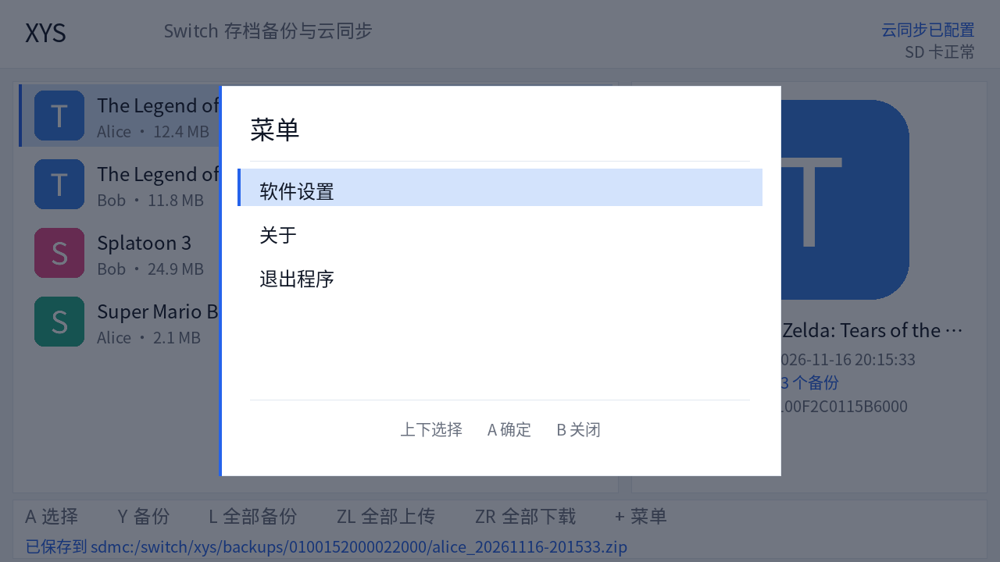
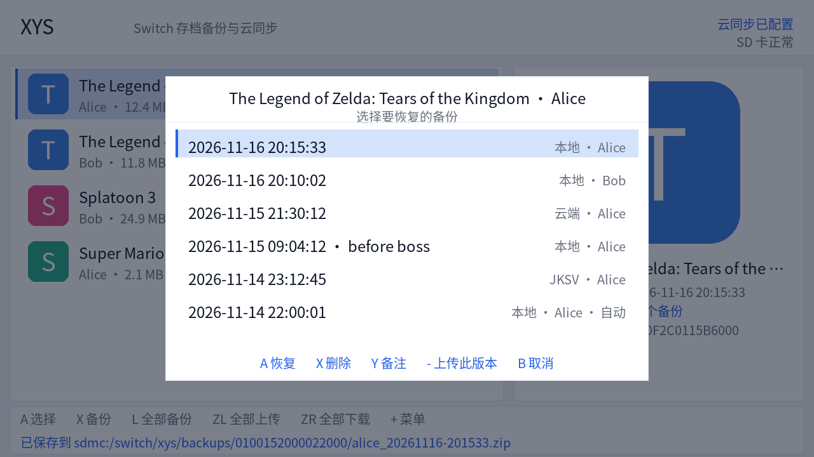
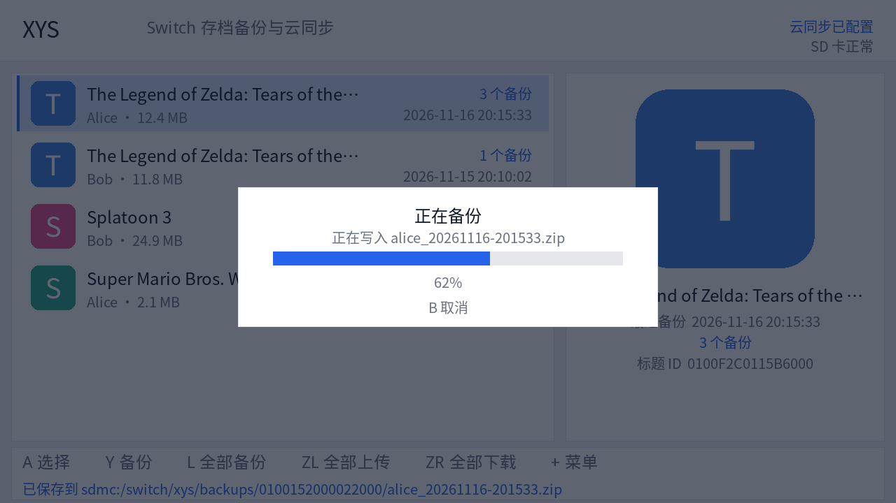
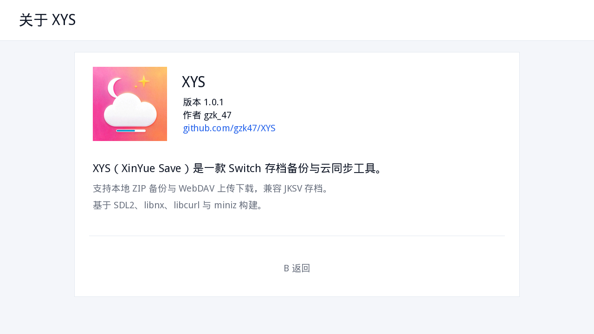

# XYS（XinYue Save）

Switch 存档备份与云同步工具。支持本地 ZIP 备份与 WebDAV 上传下载，兼容 JKSV 存档。

- 适用环境：Atmosphere + hbmenu


---

## 功能

- **本地备份**：为选中的游戏生成 ZIP 备份，存档内容与上一份相同时自动跳过
- **恢复**：从本地、JKSV 或云端任意版本恢复，覆盖前会校验 ZIP 并默认自动生成一份快照
- **云同步**：WebDAV 上传 / 下载单版本，或一键同步全部游戏的最新备份
- **图标同步**：备份时把游戏图标一并上传，下载备份时补回本地缺失的图标。名称缺失（显示 Unknown）或标题相似难以分辨时，可以看图标区分游戏，不用只靠 Title ID；只在云端或本地缺失时才传输，失败不影响备份结果
- **列表排序**：依次为数字、英文（忽略大小写）、中文（拼音首字母）、其他文字（按码点），纯符号与空名排最后，中英文混排也不会忽上忽下
- **批量操作**：全部备份、全部上传、全部下载，结束后统计成功 / 跳过 / 失败
- **备份管理**：查看备份列表、编辑备注、删除本地或云端版本
- **自动清理**：每个账号按设定份数保留最近的备份，避免 SD 卡被占满
- **多语言**：跟随系统语言切换（英、简中、繁中、日、韩、法、德、意、西、荷、葡、俄）
- 手柄操作、操作音效、备份时间与游戏图标预览

### 安全设计

- **归属校验**：恢复前比对存档所属游戏，包不属于该游戏时直接拒绝，不会写错存档。
- **类型隔离**：用户存档、设备数据（Device）、活动数据（BCAT）分开管理，类型不符不写入。
- **恢复前快照**：可开启，恢复前自动留一份当前存档，误操作也能回退。
- **元数据可缺省**：包内记录缺失或损坏时仍可恢复，不会被直接拒绝。

---

## 安装

1. 把 `xys.nro` 放到 SD 卡的 `sd:/switch/` 目录
2. 在 hbmenu 中运行

首次运行会自动创建 `sd:/switch/xys/`，其中 `config.ini` 是配置、`backups/` 存放备份。

---

## 按键

| 按键 | 作用 |
| --- | --- |
| 上下 / 左右 | 选择条目 / 翻页（摇杆同样可用） |
| A | 打开备份列表；菜单、设置中确认 |
| Y | 备份选中的游戏；备份列表中编辑本地备份的备注 |
| X | 备份列表中删除选中的备份 |
| - | 备份列表中：本地版本上传、云端版本下载 |
| L | 备份全部存档 |
| ZL / ZR | 上传 / 下载全部游戏的最新备份 |
| R | 重新扫描存档与备份 |
| B | 返回 / 取消 |
| + | 打开菜单（设置、关于、退出） |

设置界面里，`A` 编辑文字项或切换开关，`B` 返回。

---

## 配置云同步

主界面按 `+` → `软件设置`，填写云端地址、用户名、密码后立即生效。不配置也能正常使用本地备份与恢复。

以坚果云为例：

| 设置项 | 填写内容 |
| --- | --- |
| 云端地址 | `https://dav.jianguoyun.com/dav/xys` |
| 用户名 | 坚果云登录邮箱 |
| 密码 | 坚果云「第三方应用密码」 |

- 先在坚果云中**手动新建 `xys` 文件夹**，程序只会自动创建下一级的游戏目录
- 应用密码在网页端「账户设置 → 安全选项 → 第三方应用管理」生成；用登录密码会报 `401`
- 其他服务：Nextcloud 用 `https://cloud.example.com/remote.php/dav/files/<用户名>/switch-saves`，群晖用 `https://nas.example.com:5006/switch-saves`

也可以直接编辑 `sd:/switch/xys/config.ini`：

| 项目 | 说明 |
| --- | --- |
| `base_url` | WebDAV 目录，需已存在 |
| `username` / `password` | Basic Auth 账号，仅支持 Basic Auth |
| `backup_dir` | 本地备份目录，留空使用默认路径 |
| `auto_backup` | 恢复前自动快照，默认开启 |
| `sound` | 界面音效，默认开启 |
| `read_jksv` | 读取 `sd:/JKSV` 中的备份，默认开启 |
| `bcat` | 活动数据（BCAT），默认关闭 |
| `keep_backups` | 每个账号保留的备份份数，默认 10，0 = 不限制 |

HTTPS 使用内置根证书，自签名证书无法连接。

---

## 界面

1. **顶部**：程序名、云同步状态、SD 卡状态
2. **存档列表**：游戏图标、名称、账号、大小、备份数量、最近备份时间，顺序见上方「列表排序」
3. **右侧预览**：选中游戏的大图、备份时间、备份数量、Title ID
4. **底部**：按键提示与最近一次操作结果
5. **备份列表**：本地、JKSV、云端版本统一列出，按来源标注
6. **设置**：云端配置、本地配置两组
7. **关于**：版本、作者、仓库地址










游戏图标优先使用备份中缓存的图标，其次读取已安装游戏的图标，都没有时显示首字母占位。

---

## 常见操作

**备份**：列表选中游戏按 `Y`，确认后生成 ZIP；存档未变化时会跳过。昵称与保留名冲突时，备份文件名会自动加 `U_` 前缀，界面仍显示原昵称。

**恢复**：按 `A` 打开备份列表，选中版本按 `A` 确认。恢复前会先校验 ZIP，默认还会把当前存档备份一份（文件名带 `AUTO_`），快照失败则取消恢复。

**备注**：备份列表中选中本地备份按 `Y` 输入，留空即删除。建议用英文或数字。备注随上传 / 下载同步，云端与 JKSV 条目为只读。

**上传 / 下载单个版本**：备份列表中按 `-`。上传完成后列表会立即出现同时间的云端版本；下载只是保存到本地备份目录，不会覆盖当前存档。

**图标同步**：上传时若云端还没有该游戏的 `icon.jpg`，会把本地缓存的图标一并传上去；下载时只有本地缺图标才从云端取回。图标失败只影响图标显示，不影响 ZIP 的备份与恢复。

**批量同步**：主界面 `ZL` 上传、`ZR` 下载，每个游戏、每个账号只处理最新的一份普通备份，`AUTO_` 快照不参与。

**删除**：备份列表按 `X` 并确认，删除后无法恢复。

**批量与单次任务**都显示进度，按 `B` 可取消；恢复过程不可中途取消。

---

## 常见问题

| 提示 | 原因 |
| --- | --- |
| 请先在设置中配置云端地址 | 未填写云端地址 |
| HTTP 401 | 用户名或密码错误，或用了登录密码 |
| HTTP 404 | 云端地址不存在 |
| MKCOL HTTP 409 | 云端上级目录不存在，需先手动创建 |
| 网络错误 / 连接超时 | 网络不可达或 DNS 失败 |
| 备份文件损坏或格式不受支持 | 下载到的是错误页面或 ZIP 不完整 |

恢复前请**完全关闭游戏**；恢复会覆盖当前存档，重要存档建议先手动备份。

已知边界：

- 只处理用户存档、设备数据与活动数据，不处理系统存档与缓存存档：这两类数据由系统管理，恢复不当可能影响系统稳定性，因此主动排除
- 外部备份只扫描 `sd:/JKSV`
- 不做增量同步，备份列表手动选择版本
- 存档内容为游戏私有格式，暂不解析数值

---

## 从源码构建

需要 devkitPro 与 switch-dev、switch-curl、switch-mbedtls、switch-zlib、switch-sdl2、switch-sdl2_image、switch-sdl2_ttf、switch-freetype：

```bash
make
```

产物为 `xys.nro`（约 9.5 MiB）。推送 `main` 后由 GitHub Actions 自动构建并发布 Release。

---

## 第三方许可

- 字体：使用 Switch 系统内置共享字体，不随软件分发
- ZIP：miniz，MIT / public domain
